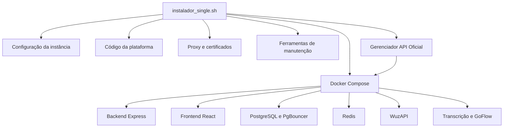

> Referência histórica: descreve os scripts preservados em legacy/. Para o instalador Docker-only atual, consulte ../README.md e 01-contexto-para-ia.md. Os caminhos antigos de scripts/tools recebem o prefixo legacy/.

# Arquitetura e integração com a plataforma

O menu principal é orientado a Docker Compose, mas o script monolítico também contém instalação nativa por etapas, PM2, ferramentas históricas e caminhos de alta performance. Esses caminhos não são intercambiáveis.

## Componentes da aplicação

| Serviço | Papel | Persistência ou dependências |
| --- | --- | --- |
| backend | Express e TypeScript, atendimento, conectores e filas | Sequelize, banco, Redis, mídias e autenticação de sessões |
| frontend | React, telas e configuração operacional | API e Socket.IO; URL de backend em build e runtime |
| postgres | Banco relacional | Volumes e dumps próprios |
| pgbouncer | Pool de conexões PostgreSQL | Configuração compatível com o banco e consumidores |
| redis | Filas, cache e tokens temporários | Persistência conforme a implantação |
| wuzapi | Canal WhatsMeow | Estado e credenciais próprios |
| api_transcricao | Flask, conversão de áudio e reconhecimento | FFmpeg e reconhecimento externo |
| goflow_dispatcher | Despacho de campanhas | Contrato configurado no backend |
| api_oficial | NestJS e Prisma, integração Meta | Banco da API, tokens e arquivos públicos |

A cópia da aplicação analisada anteriormente não contém todo o conjunto de serviços e o Compose esperado pelo instalador. WuzAPI, GoFlow e a orquestração podem vir de outra revisão ou de imagens. Não inventar seus contratos internos com base apenas nos nomes.

## Repositórios e artefatos

O README aponta para `https://github.com/alansuporteamanda/Instalador-AMANDA.git` e `https://github.com/alansuporteamanda/AMANDA.git`. Esses endereços são referências do código local, sem verificação remota nesta análise. Algumas bibliotecas sincronizam o `origin` já configurado e suportam outros repositórios históricos.

O instalador gera ou modifica `.env`, Dockerfiles, YAML, configuração Nginx e scripts auxiliares. Uma mudança no Shell pode quebrar Python, SQL, YAML ou Dockerfile dentro de um heredoc sem causar erro de sintaxe Bash. Validar também o artefato gerado.

## Autoridade das fontes

Para saber o que será executado, leia a opção do menu e sua função chamada. Para saber o que está implantado, consulte a configuração e os recursos da instância real. O README ajuda a entender intenção, mas diverge do fluxo atual em alguns pontos; os achados estão no documento de diagnóstico.
